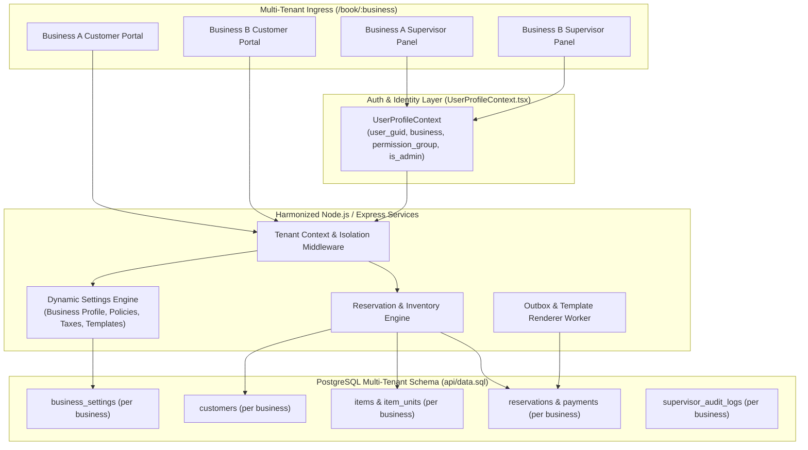
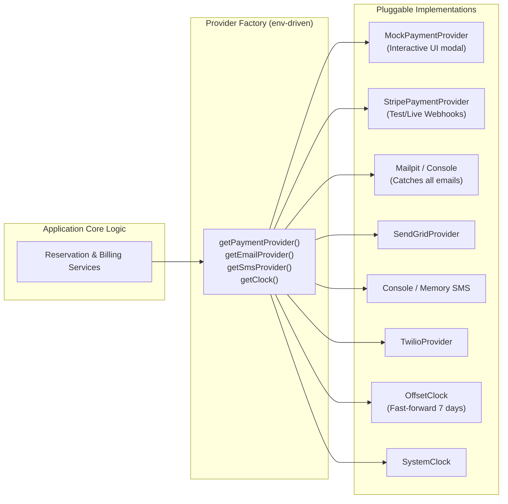

# Triple Great — Harmonized Enterprise System Specification

**Multi-Tenant Item Reservation Engine & Supervisor Control Panel**  
Technical Architecture, User Stories & Developer Experience Guide

| Version | Date       | Notes                                                                                                |
| :------ | :--------- | :--------------------------------------------------------------------------------------------------- |
| 1.0     | —          | Original single-tenant `userstory.txt`                                                               |
| 2.0     | 2026-10-22 | Markdown rewrite: fixed cancellation logic, database-backed holds, notifications & dev mock layers     |
| 2.1-2.3 | 2026-10-22 | Clarified payment in full, tax inclusion, and split Reschedule vs Add Days vs Remove Days            |
| 3.0     | 2026-10-22 | **Enterprise Multi-Tenant Release:** Scoped by `business` (aligned with `data.sql` and `UserProfileContext.tsx`), dedicated `customers` table, zero hardcoded rules (100% panel-driven settings: business info, policies, pricing, email/SMS templates, item catalog, and audit log viewer). |
| 3.1     | 2026-10-22 | Decoupled `customers` from `users_table` (zero foreign key/link). Global `UserProfileContext` classification: users whose `permission_group` is not 'Admin', 'Supervisor', or 'Agent' are treated as Customers. Every transaction is recorded as a customer transaction. |

---

## Table of Contents

1. [Enterprise Architecture & Multi-Tenancy Overview](#1-enterprise-architecture--multi-tenancy-overview)
2. [Authentication, Roles & UserProfileContext Integration](#2-authentication-roles--userprofilecontext-integration)
3. [Zero-Hardcoding Principle: The Dynamic Settings Engine](#3-zero-hardcoding-principle-the-dynamic-settings-engine)
4. [Reservation & Policy Engine (Tenant-Configurable)](#4-reservation--policy-engine-tenant-configurable)
5. [Story CUST-100 — Dedicated Customer Registry & Auth Choice](#5-story-cust-100--dedicated-customer-registry--auth-choice)
6. [Story INV-102 — Customer Booking, Checkout & Self-Service](#6-story-inv-102--customer-booking-checkout--self-service)
7. [Story ADM-201 — Supervisor Control Panel & Dynamic Settings](#7-story-adm-201--supervisor-control-panel--dynamic-settings)
8. [Story NTF-301 — Template-Driven Dynamic Notifications (Email & SMS)](#8-story-ntf-301--template-driven-dynamic-notifications-email--sms)
9. [Story DEV-401 — Developer Experience, Mock Providers & Time Travel](#9-story-dev-401--developer-experience-mock-providers--time-travel)
10. [Harmonized Enterprise Data Schema (`data.sql` Extension)](#10-harmonized-enterprise-data-schema-datasql-extension)
11. [API Specification Summary](#11-api-specification-summary)
12. [Verification Checklist & Guardrails](#12-verification-checklist--guardrails)

---

## 1. Enterprise Architecture & Multi-Tenancy Overview

The platform operates as a **multi-tenant enterprise solution**. Multiple businesses run on the same infrastructure, but each business functions with complete operational and data isolation:

- **Strict Tenant Scoping:** Every entity—items, serialized units, reservations, customers, blackouts, audit logs, CMS assets, and system configuration settings—is partitioned by `business VARCHAR(100)` (matching the design pattern established in `api/data.sql`).
- **Dynamic Supervisor Control Panel:** Each business supervisor manages their own operational settings, pricing, cancellation/reschedule thresholds, hold timers, business profile, item catalog, and notification templates independently from the control panel. **No policies, rates, or templates are hardcoded in the codebase.**
- **Public Reservation Routing:** Public booking portals are tenant-aware (resolved via URL route `/book/:business`, subdomain, or stored session context).



---

## 2. Authentication, Roles & UserProfileContext Integration

### 2.1 Role & Session Resolution
Supervisor account management is **explicitly out of scope** for this module. Identity and permissions are governed across all pages by `UserProfileContext.tsx`:

- **Universal Profile Visibility:** `UserProfileContext` is active and accessible across every public and administrative page.
- **Role Classification & Customer Default:**
  - **Staff / Admin / Supervisor / Agent:** If `profile.permission_group IN ('Admin', 'Supervisor', 'Agent')` OR `profile.is_admin = true`, the user possesses elevated permissions to access the supervisor control panel for their assigned `profile.business`.
  - **Customer:** If `profile.permission_group` is NOT in `('Admin', 'Supervisor', 'Agent')` (or if the user is unauthenticated / has no profile), **the user is classified as a Customer**.
- **Every Transaction is a Customer Transaction:** All booking and checkout flows write directly to the independent `customers` table. There is **strictly no link or foreign key** between the `customers` table and `users_table`.
- **Server-Side Authorization (`requireSupervisor` middleware):**
  - Enforces: `(permission_group IN ('Admin', 'Supervisor', 'Agent') OR is_admin = true) AND business = req.params.business`.
  - Re-checks the database role on administrative mutation endpoints so revocations apply immediately.
  - Returns `401 Unauthorized` for missing/invalid credentials, and `403 Forbidden` for non-supervisors or cross-tenant access attempts.

---

## 3. Zero-Hardcoding Principle: The Dynamic Settings Engine

**Zero business constants are stored in static source code.** All operational variables are stored in the database per business (`business_settings` and `business_templates`) and edited via the Supervisor Control Panel.

### 3.1 Dynamic Settings Catalog (Configured per Business)

| Category | Setting Key | Description | Default Fallback |
| :--- | :--- | :--- | :--- |
| **Business Info** | `business_name` | Public legal or brand name | string |
| | `contact_email` | Customer support email | string |
| | `contact_phone` | Support phone number | string |
| | `physical_address` | Pickup / store address | string |
| | `timezone` | Operating timezone for day boundaries & cutoffs | `America/Los_Angeles` |
| | `currency` | Currency code | `USD` |
| **Policy Engine** | `hold_ttl_seconds` | Checkout inventory lock duration | `600` (10 min) |
| | `free_change_cutoff_hours` | Self-service 100% refund cutoff window | `168` (7 days) |
| | `late_fee_percentage` | Fee percentage retained within cutoff | `25` (%) |
| | `allow_customer_add_days` | Enable self-service day extensions | `true` |
| | `allow_customer_remove_days`| Enable self-service day reductions | `true` |
| | `guest_token_ttl_days` | Validity duration of tokenized guest links | `30` |
| **Pricing & Tax** | `tax_rate_percent` | Sales tax percentage added at checkout | e.g. `8.25` (%) |
| | `require_full_payment` | Full payment at booking flag | `true` |
| **Notifications** | `sms_enabled` | Master SMS notification switch for tenant | `true` |
| | `email_enabled` | Master Email notification switch for tenant | `true` |
| | `reminder_lead_hours` | Pre-reservation reminder lead time | `48` |

---

## 4. Reservation & Policy Engine (Tenant-Configurable)

All policy evaluations dynamically pull the active settings for `req.business`:

```ts
const settings = await getBusinessSettings(businessId);
const cutoffHours = settings.free_change_cutoff_hours; // e.g. 168
const lateFeePct = settings.late_fee_percentage;       // e.g. 25
```

### 4.1 Lifecycle Actions Matrix

| Action | When Allowed | Price / Fee Calculation | Inventory Effect |
| :--- | :--- | :--- | :--- |
| **Checkout Hold** | Availability > 0 | Holds 1 unit for `hold_ttl_seconds` | Temporarily decrements visible pool |
| **Full Cancellation (Early)** | `now <= start_instant - cutoff_hours` | **100% refund** of total paid (tax included) | Unit immediately released |
| **Late Cancellation** | `start_instant - cutoff_hours < now < start_instant` | **25% late fee** retained; **75% refund** | Unit immediately released |
| **Cancellation (After Start)**| `now >= start_instant` | Self-service disabled; Supervisor override only | Unit released on manual approval |
| **Reschedule (Same Duration)**| `now < start_instant` & new range available | If $\ge$ cutoff: **$0 fee**.<br/>If $<$ cutoff: **25% fee** on original total paid. | Reallocated to free unit for new range |
| **Add Days (Extend Booking)** | Target dates free & adjacent | **No change fee**.<br/>Charges: $\Delta\text{days} \times \text{daily\_rate} + \text{tax}$. | Holds & confirms adjacent days |
| **Remove Days (Shorten)** | `now < start_instant` & $\ge 1$ day remains | Removed portion evaluated against cancellation policy (100% early / 75% late refund). | Removed dates released to pool |

---

## 5. Story CUST-100 — Dedicated Customer Registry (Decoupled from `users_table`)

| Attribute | Details |
| :--- | :--- |
| **Story ID** | CUST-100 |
| **Epic** | Customer Identity & Multi-Tenant Registry |
| **Title** | Dedicated Multi-Tenant Customer Table Completely Independent from `users_table` |
| **Status** | Ready for Development |

### Description
- **As a** customer making a reservation,
- **I want my** booking recorded in a dedicated customer registry without creating or requiring an account in `users_table`,
- **So that** reservations are decoupled from internal system user accounts and checkout remains frictionless.

### Acceptance Criteria
```gherkin
Feature: Dedicated Independent Customer Record Management

  Scenario: Customer Checkout & Profile Auto-Fill
    Given a user navigating the public booking portal on "/book/:business"
    When they initiate checkout
    Then if "UserProfileContext" has an active profile (where permission_group is not Admin, Supervisor, or Agent)
    And the checkout form pre-populates first_name, last_name, email, and phone for convenience
    And unauthenticated visitors manually input their contact details

  Scenario: Storing Customer Data (No link to users_table)
    When the customer completes checkout
    Then the system creates or updates a record in the dedicated "customers" table scoped to "business"
    And the "customers" table has NO foreign key or column linking to "users_table"
    And the reservation is tied solely to "customers.customer_guid"
    And a tokenized management link is generated for self-service cancellation/reschedule/extensions
```

---

## 6. Story INV-102 — Customer Booking, Checkout & Self-Service

| Attribute | Details |
| :--- | :--- |
| **Story ID** | INV-102 |
| **Epic** | Item Reservation & Customer Experience |
| **Title** | Multi-Tenant Availability Search, Dynamic Checkout Hold, and Policy-Driven Self-Service |
| **Status** | Ready for Development |

### Acceptance Criteria
```gherkin
Feature: Multi-Tenant Booking & Self-Service Lifecycle

  Scenario: Tenant-Scoped Availability and Blackouts
    Given business "alpha_rentals" has 3 units of Item X
    And business "beta_rentals" has 2 units of Item X
    When a customer searches availability on "/book/alpha_rentals"
    Then only units and blackouts belonging to "alpha_rentals" are evaluated
    And blackouts in "beta_rentals" have zero effect on "alpha_rentals"

  Scenario: Atomic Checkout Hold Expiration
    Given an available unit in the selected business
    When the customer initiates checkout
    Then the system creates a HOLD reservation for "settings.hold_ttl_seconds"
    And a countdown timer displays the remaining seconds on screen
    And if the timer hits 0 before payment, the hold expires and the unit returns to the pool

  Scenario: Self-Service Add Days (Extension)
    Given an active CONFIRMED reservation
    When the customer extends the end date by 2 days
    Then the system checks availability for those 2 days in the business inventory
    And if available, holds the extra days and charges (2 * daily_rate + tax) with no fee
    And updates the reservation range and notifies the customer

  Scenario: Self-Service Remove Days (Reduction)
    Given an active CONFIRMED reservation of 4 days with $400 paid
    And the customer requests to drop the final day 10 days before start
    Then the system computes the 1-day value ($100), applies 0% fee (>= cutoff), and refunds $100
    And the reservation duration is shortened and the freed day is immediately bookable
```

---

## 7. Story ADM-201 — Supervisor Control Panel & Dynamic Settings

| Attribute | Details |
| :--- | :--- |
| **Story ID** | ADM-201 |
| **Epic** | Back-Office Administration & Operations |
| **Title** | Supervisor Control Panel: Business Profile, Catalog, Dynamic Policies, Templates, and Audit Log Viewer |
| **Status** | Ready for Development |

### Acceptance Criteria
```gherkin
Feature: Complete Supervisor Configuration & Operational Hub

  Scenario: Dynamic Business Profile & Operating Hours
    Given a supervisor logged into "/admin/:business"
    When they navigate to "Settings -> Business Profile"
    And update business name, timezone, support email, phone, and pickup address
    Then the changes persist to "business_settings"
    And all future customer emails and public booking pages reflect the new profile immediately

  Scenario: Dynamic Policy & Pricing Configuration
    Given a supervisor managing business policies
    When they change "late_fee_percentage" to 30% and "hold_ttl_seconds" to 900
    Then no code deployment is required
    And all subsequent holds and late cancellations calculate using the updated values

  Scenario: Item & Inventory Catalog Management
    Given a supervisor in the Item Catalog screen
    When they create a new item (name, description, daily_rate_cents, images)
    And add 3 serialized units with unique serial numbers
    Then the new item and its capacity become available on the public booking portal

  Scenario: Dynamic Email & SMS Template Studio
    Given a supervisor editing the "booking.confirmed" template
    When they modify the subject line and body using tokens like "{{customer_name}}" and "{{start_date}}"
    Then test preview renders the sample output
    And subsequent customer confirmation messages utilize the updated custom template

  Scenario: Supervisor Audit Log Viewer
    Given a supervisor opening the "Audit Log" dashboard tab
    When they filter by date range, actor, or action type (e.g., "FEE_WAIVED", "POLICY_UPDATE")
    Then the UI renders a table of events with timestamps, actor user_guid, and entity references
    And clicking an event opens a modal with a side-by-side JSON diff (before vs. after)
```

---

## 8. Story NTF-301 — Template-Driven Dynamic Notifications (Email & SMS)

| Attribute | Details |
| :--- | :--- |
| **Story ID** | NTF-301 |
| **Epic** | Customer Communications & Outbox |
| **Title** | Business-Scoped Template Rendering via Outbox Worker |
| **Status** | Ready for Development |

### 8.1 Template Catalog (Editable in Supervisor Panel)

Every business has editable templates in `business_templates` for each lifecycle event:

| Event Identifier | Supported Channels | Available Variable Tokens |
| :--- | :--- | :--- |
| `booking.confirmed` | Email & SMS | `{{business_name}}`, `{{customer_name}}`, `{{item_name}}`, `{{start_date}}`, `{{end_date}}`, `{{total_amount}}`, `{{manage_url}}`, `{{support_phone}}` |
| `booking.rescheduled` | Email & SMS | `{{old_start_date}}`, `{{new_start_date}}`, `{{fee_amount}}`, `{{manage_url}}` |
| `booking.days_added` | Email & SMS | `{{added_days_count}}`, `{{new_end_date}}`, `{{amount_charged}}`, `{{manage_url}}` |
| `booking.days_removed` | Email & SMS | `{{removed_days_count}}`, `{{refund_amount}}`, `{{fee_amount}}`, `{{new_total}}` |
| `booking.cancelled` | Email & SMS | `{{refund_amount}}`, `{{fee_amount}}`, `{{refund_eta_days}}`, `{{business_name}}` |
| `booking.reminder_48h` | Email & SMS | `{{customer_name}}`, `{{pickup_address}}`, `{{start_date}}`, `{{support_phone}}` |

### 8.2 Outbox Pattern Delivery Guarantees
- Notifications are inserted into `notification_outbox` in the **same database transaction** as the reservation update.
- A background worker fetches pending records, loads the business's custom template, interpolates variables, and hands the message off to `EmailProvider` / `SmsProvider`.
- Outages in external communication providers **never** roll back customer reservations.

---

## 9. Story DEV-401 — Developer Experience, Mock Providers & Time Travel

| Attribute | Details |
| :--- | :--- |
| **Story ID** | DEV-401 |
| **Epic** | Developer Experience & QA Tooling |
| **Title** | Pluggable Provider Interfaces, Local Mocks, Notification Inspector & Time Travel |
| **Status** | Ready for Development — **Implement First** |

### 9.1 Workarounds & Provider Matrix



- **Interactive Test Payment Panel:** In development mode (`PAYMENT_PROVIDER=mock`), checkout renders test buttons (`Success`, `Decline`, `Simulate Delay`, `Abandon`) feeding directly into the real webhook dispatcher.
- **Outbox Inspector (`/dev/outbox`):** Devs and QA can inspect all dispatched emails and SMS messages in their browser and click tokenized guest management links without a real mailbox or phone.
- **Time Travel Engine (`/dev/clock`):** Fast-forward system time by $N$ hours to test 7-day cancellation cutoffs, automated reminders, and hold expirations in seconds.
- **Production Guardrail:** If `NODE_ENV=production`, the application refuses to start if any mock provider or dev route is enabled.

---

## 10. Harmonized Enterprise Data Schema (`data.sql` Extension)

Extends the current `api/data.sql` schema (`users_table`, `events_table`, `reps_table`, etc.) using the identical `business VARCHAR(100)` tenant pattern:

```sql
-- 1. Dedicated Customers Table (Completely Independent from users_table)
CREATE TABLE IF NOT EXISTS customers (
    id SERIAL,
    customer_guid VARCHAR(50) PRIMARY KEY,
    business VARCHAR(100) NOT NULL,
    first_name VARCHAR(50) NOT NULL,
    last_name VARCHAR(50) NOT NULL,
    email VARCHAR(100) NOT NULL,
    phone_number VARCHAR(20) NOT NULL,
    sms_opt_in BOOLEAN DEFAULT FALSE,
    time_created TIMESTAMP DEFAULT CURRENT_TIMESTAMP,
    time_modified TIMESTAMP DEFAULT CURRENT_TIMESTAMP
);
CREATE INDEX idx_customers_business_email ON customers(business, email);

-- 2. Business Dynamic Settings Table (Zero Hardcoded Logic)
CREATE TABLE IF NOT EXISTS business_settings (
    id SERIAL,
    business VARCHAR(100) NOT NULL,
    setting_key VARCHAR(50) NOT NULL,
    setting_value JSONB NOT NULL,
    time_modified TIMESTAMP DEFAULT CURRENT_TIMESTAMP,
    PRIMARY KEY (business, setting_key)
);

-- 3. Dynamic Message Templates (Email & SMS per Business)
CREATE TABLE IF NOT EXISTS business_templates (
    id SERIAL,
    template_guid VARCHAR(50) PRIMARY KEY,
    business VARCHAR(100) NOT NULL,
    event_type VARCHAR(50) NOT NULL,     -- booking.confirmed, booking.cancelled, etc.
    channel VARCHAR(10) NOT NULL,        -- 'EMAIL' or 'SMS'
    subject VARCHAR(200),               -- Nullable for SMS
    body_template TEXT NOT NULL,         -- Handlebars syntax
    is_active BOOLEAN DEFAULT TRUE,
    time_modified TIMESTAMP DEFAULT CURRENT_TIMESTAMP,
    UNIQUE(business, event_type, channel)
);

-- 4. Item Catalog (Configured via Supervisor Panel)
CREATE TABLE IF NOT EXISTS items (
    id SERIAL,
    item_guid VARCHAR(50) PRIMARY KEY,
    business VARCHAR(100) NOT NULL,
    name VARCHAR(100) NOT NULL,
    description TEXT,
    daily_rate_cents INTEGER NOT NULL,
    images JSONB DEFAULT '[]'::jsonb,
    is_active BOOLEAN DEFAULT TRUE,
    time_created TIMESTAMP DEFAULT CURRENT_TIMESTAMP,
    time_modified TIMESTAMP DEFAULT CURRENT_TIMESTAMP
);
CREATE INDEX idx_items_business ON items(business);

-- 5. Physical Serialized Units Linked to Items
CREATE TABLE IF NOT EXISTS item_units (
    id SERIAL,
    unit_guid VARCHAR(50) PRIMARY KEY,
    business VARCHAR(100) NOT NULL,
    item_guid VARCHAR(50) NOT NULL,
    serial_number VARCHAR(100) NOT NULL,
    is_active BOOLEAN DEFAULT TRUE,
    time_created TIMESTAMP DEFAULT CURRENT_TIMESTAMP,
    FOREIGN KEY (item_guid) REFERENCES items(item_guid) ON DELETE CASCADE
);
CREATE INDEX idx_units_item ON item_units(item_guid);

-- 6. Reservations (Multi-Tenant, PostgreSQL GIST Exclusion Protected)
CREATE TABLE IF NOT EXISTS reservations (
    id SERIAL,
    reservation_guid VARCHAR(50) PRIMARY KEY,
    business VARCHAR(100) NOT NULL,
    item_guid VARCHAR(50) NOT NULL,
    unit_guid VARCHAR(50) NOT NULL,
    customer_guid VARCHAR(50) NOT NULL,
    date_range DATERANGE NOT NULL,
    status VARCHAR(20) NOT NULL DEFAULT 'HOLD', -- HOLD, CONFIRMED, CANCELLED, EXPIRED, COMPLETED
    hold_expires_at TIMESTAMP WITH TIME ZONE,
    subtotal_cents INTEGER NOT NULL,
    tax_cents INTEGER NOT NULL,
    total_cents INTEGER NOT NULL,               -- Full charge (tax included)
    fee_cents INTEGER DEFAULT 0,
    refund_cents INTEGER DEFAULT 0,
    cancelled_at TIMESTAMP WITH TIME ZONE,
    cancelled_by VARCHAR(50),
    time_created TIMESTAMP DEFAULT CURRENT_TIMESTAMP,
    time_modified TIMESTAMP DEFAULT CURRENT_TIMESTAMP,
    FOREIGN KEY (item_guid) REFERENCES items(item_guid),
    FOREIGN KEY (unit_guid) REFERENCES item_units(unit_guid),
    FOREIGN KEY (customer_guid) REFERENCES customers(customer_guid)
);
CREATE INDEX idx_reservations_business ON reservations(business);
CREATE INDEX idx_reservations_customer ON reservations(customer_guid);

-- Exclusion constraint preventing double booking on active units
ALTER TABLE reservations ADD CONSTRAINT no_overlapping_active_reservations
    EXCLUDE USING gist (unit_guid WITH =, date_range WITH &&)
    WHERE (status IN ('HOLD', 'CONFIRMED'));

-- 7. Reservation Changes Log (Reschedules, Add Days, Remove Days)
CREATE TABLE IF NOT EXISTS reservation_changes (
    id SERIAL,
    change_guid VARCHAR(50) PRIMARY KEY,
    business VARCHAR(100) NOT NULL,
    reservation_guid VARCHAR(50) NOT NULL,
    change_type VARCHAR(20) NOT NULL, -- 'RESCHEDULE', 'ADD_DAYS', 'REMOVE_DAYS'
    old_range DATERANGE NOT NULL,
    new_range DATERANGE NOT NULL,
    old_unit_guid VARCHAR(50),
    new_unit_guid VARCHAR(50),
    fee_cents INTEGER DEFAULT 0,
    extra_charge_cents INTEGER DEFAULT 0,
    refund_cents INTEGER DEFAULT 0,
    fees_waived BOOLEAN DEFAULT FALSE,
    actor_guid VARCHAR(50) NOT NULL,
    reason TEXT,
    time_created TIMESTAMP DEFAULT CURRENT_TIMESTAMP,
    FOREIGN KEY (reservation_guid) REFERENCES reservations(reservation_guid) ON DELETE CASCADE
);

-- 8. Ledger of Payments & Refunds
CREATE TABLE IF NOT EXISTS payments (
    id SERIAL,
    payment_guid VARCHAR(50) PRIMARY KEY,
    business VARCHAR(100) NOT NULL,
    reservation_guid VARCHAR(50) NOT NULL,
    type VARCHAR(20) NOT NULL,       -- 'CHARGE', 'REFUND'
    purpose VARCHAR(30) NOT NULL,    -- 'BOOKING', 'CHANGE_FEE', 'ADD_DAYS', 'REMOVE_DAYS_REFUND', 'CANCEL_REFUND'
    amount_cents INTEGER NOT NULL,
    provider VARCHAR(20) NOT NULL,   -- 'stripe', 'mock'
    provider_ref VARCHAR(100),
    status VARCHAR(20) NOT NULL,     -- 'PENDING', 'SUCCEEDED', 'FAILED', 'MANUAL'
    idempotency_key VARCHAR(100) UNIQUE NOT NULL,
    attempts INTEGER DEFAULT 1,
    time_created TIMESTAMP DEFAULT CURRENT_TIMESTAMP,
    FOREIGN KEY (reservation_guid) REFERENCES reservations(reservation_guid) ON DELETE CASCADE
);

-- 9. Inventory Blackout Dates
CREATE TABLE IF NOT EXISTS inventory_blackouts (
    id SERIAL,
    blackout_guid VARCHAR(50) PRIMARY KEY,
    business VARCHAR(100) NOT NULL,
    item_guid VARCHAR(50),           -- Nullable = entire business blackout
    date_range DATERANGE NOT NULL,
    reason TEXT NOT NULL,
    created_by VARCHAR(50) NOT NULL,
    time_created TIMESTAMP DEFAULT CURRENT_TIMESTAMP
);

-- 10. Supervisor Audit Logs (Viewable in Admin Control Panel)
CREATE TABLE IF NOT EXISTS supervisor_audit_logs (
    id SERIAL,
    log_guid VARCHAR(50) PRIMARY KEY,
    business VARCHAR(100) NOT NULL,
    actor_guid VARCHAR(50) NOT NULL,
    action VARCHAR(50) NOT NULL,     -- 'SETTINGS_UPDATE', 'FEE_WAIVED', 'MANUAL_RESCHEDULE', 'OVERRIDE_CANCEL'
    entity_type VARCHAR(50) NOT NULL,
    entity_guid VARCHAR(50) NOT NULL,
    reason TEXT,
    before_state JSONB,
    after_state JSONB,
    time_created TIMESTAMP DEFAULT CURRENT_TIMESTAMP
);
CREATE INDEX idx_audit_business ON supervisor_audit_logs(business);

-- 11. Transactional Notification Outbox
CREATE TABLE IF NOT EXISTS notification_outbox (
    id SERIAL,
    outbox_guid VARCHAR(50) PRIMARY KEY,
    business VARCHAR(100) NOT NULL,
    reservation_guid VARCHAR(50),
    recipient VARCHAR(100) NOT NULL,
    channel VARCHAR(10) NOT NULL,
    template_type VARCHAR(50) NOT NULL,
    payload JSONB NOT NULL,
    rendered_body TEXT,
    status VARCHAR(20) DEFAULT 'PENDING', -- PENDING, SENT, FAILED
    attempts INTEGER DEFAULT 0,
    provider_message_id VARCHAR(100),
    error_message TEXT,
    time_created TIMESTAMP DEFAULT CURRENT_TIMESTAMP,
    sent_at TIMESTAMP WITH TIME ZONE
);
```

---

## 11. API Specification Summary

All endpoints are tenant-aware, accepting the tenant identifier via path parameter (`:business`).

### 11.1 Public Booking Portal API
| Method | Path | Auth | Purpose |
| :--- | :--- | :--- | :--- |
| `GET` | `/api/:business/config` | Public | Returns public business info, taxes, policies, announcements |
| `GET` | `/api/:business/items` | Public | List active items and catalog metadata |
| `GET` | `/api/:business/items/:id/availability` | Public | Date range availability calculation & disabled dates |
| `POST` | `/api/:business/reservations/hold` | Public | Creates 10-minute inventory hold on a unit |
| `DELETE`| `/api/:business/reservations/:id/hold` | Hold Owner | Release temporary checkout hold early |
| `POST` | `/api/:business/checkout/process` | Public | Process payment, register/link customer, confirm hold |
| `POST` | `/api/:business/payments/webhook` | Signature | Stripe / Mock payment success & decline webhook |
| `GET` | `/api/:business/reservations/:id/quote` | Token/Auth | Calculate fees/refunds for cancel/reschedule/add/remove |
| `POST` | `/api/:business/reservations/:id/cancel` | Token/Auth | Self-service cancellation |
| `POST` | `/api/:business/reservations/:id/reschedule`| Token/Auth | Self-service reschedule (same duration) |
| `POST` | `/api/:business/reservations/:id/add-days` | Token/Auth | Self-service date extension |
| `POST` | `/api/:business/reservations/:id/remove-days`| Token/Auth | Self-service date reduction |
| `GET` | `/api/:business/manage/:token` | Token Link | Authenticate guest access for single reservation |

### 11.2 Supervisor Administration API (`requireSupervisor`)
| Method | Path | Purpose |
| :--- | :--- | :--- |
| `GET/PUT` | `/api/admin/:business/settings` | Read / update dynamic business profile, policies, and taxes |
| `GET/PUT` | `/api/admin/:business/templates/:event` | Read / edit email & SMS template text and variables |
| `GET/POST`| `/api/admin/:business/items` | Item catalog CRUD (create items, edit daily rates, upload images) |
| `POST/DEL`| `/api/admin/:business/items/:id/units` | Add or deactivate physical serialized inventory units |
| `GET/POST`| `/api/admin/:business/blackouts` | List or create date blackouts with conflict detection |
| `GET` | `/api/admin/:business/reservations` | Search, filter, and inspect customer bookings |
| `POST` | `/api/admin/:business/reservations/manual` | Create booking (offline cash / payment link options) |
| `POST` | `/api/admin/:business/reservations/:id/override`| Supervisor override (cancel/reschedule with fee-waiver + reason) |
| `GET` | `/api/admin/:business/audit-logs` | Query supervisor action logs with filtering and JSON diffs |
| `GET/POST`| `/api/admin/:business/refunds/queue` | Inspect and retry failed refunds or mark resolved manually |

### 11.3 Development & QA Tooling API (`NODE_ENV !== 'production'`)
| Method | Path | Purpose |
| :--- | :--- | :--- |
| `GET` | `/dev/outbox` | Render HTML inspector of queued/sent customer emails & SMS |
| `GET/POST`| `/dev/clock` | Inspect or advance simulated time (`offsetHours`) |
| `POST` | `/dev/payments/fail-next` | Force next mock payment or refund to decline |
| `POST` | `/dev/jobs/:name/run` | Manually trigger sweeper, reminder, or refund worker |

---

## 12. Verification Checklist & Guardrails

- [x] **Multi-Tenant Boundary Isolation:** A supervisor of `business_A` cannot access or mutate settings, items, or reservations belonging to `business_B` (returns `403 Forbidden`).
- [x] **Zero Hardcoded Logic:** All policies (cutoff hours, fee percentages, hold TTLs, tax rates, daily rates) are dynamically loaded from `business_settings` and `items`.
- [x] **Decoupled Customer Model:** The `customers` table is completely independent from `users_table` with zero foreign keys. Every booking is recorded as a customer transaction.
- [x] **Concurrency & Double-Booking Protection:** PostgreSQL `btree_gist` exclusion constraint guarantees atomic unit allocation even under high concurrent checkout traffic.
- [x] **Full Tax-Inclusive Pricing:** Subtotal, tax, and total are calculated as integer cents. Fees and refunds are deterministically computed on the total charged amount.
- [x] **Reschedule vs. Add vs. Remove Days:** Rescheduling moves dates of equal length; Add Days checks availability and charges standard rates with no fee; Remove Days refunds under the cancellation policy.
- [x] **Full Auditability:** Every supervisor override, fee waiver, blackout creation, and settings update writes an immutable record to `supervisor_audit_logs` with a before/after snapshot.
- [x] **Safe Developer Mocks:** Payment, email, SMS, and time travel can be completely tested locally without external API accounts or live cards, and are automatically blocked in production.
